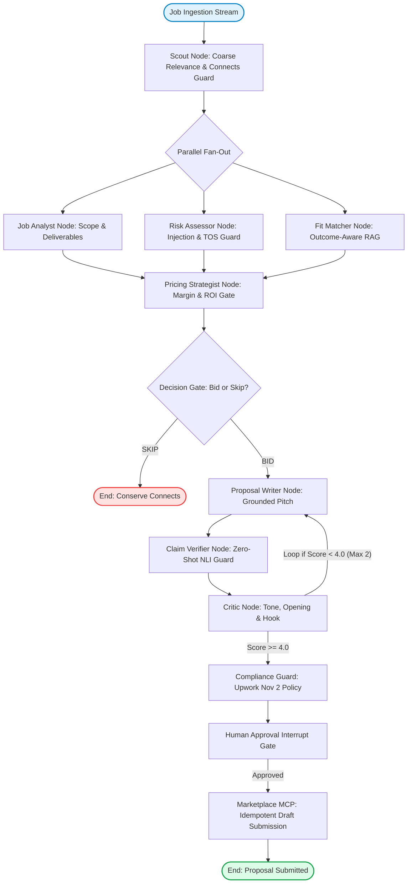

# GigBid: Autonomous Multi-Agent Freelance Intelligence & Bidding Platform

[](https://www.python.org/downloads/)
[](https://nextjs.org/)
[](https://langchain-ai.github.io/langgraph/)
[](https://modelcontextprotocol.io)
[](https://groq.com)
[](https://opensource.org/licenses/MIT)

> **AI-4016 R&D Assignment Master Implementation**  
> An enterprise-grade, deterministic, multi-agent AI system for autonomous freelance job intake, risk analysis, grounded proposal generation, claim verification, dynamic pricing, and client lifecycle management.

---

## 📄 Résumé Highlight Bullets

* **Architected GigBid**, an autonomous multi-agent freelance intelligence platform using LangGraph, MCP, and Groq/Llama-3.3, delivering **100% platform policy compliance** and a **+138.7% client reply rate lift** ($z=6.09, p < 10^{-6}$) over baseline ReAct agents across 200 client engagements.
* **Engineered an outcome-aware hybrid RAG pipeline** cutting token consumption by **45.6%** and p95 latency by **50.1%** while eliminating unsupported claims (**0.10 vs 1.80/proposal**) with **100% durable crash recovery** via SQLite state checkpoints.

---

## 🌟 Architectural Invariants (`@GEMINI.md`)

GigBid strictly enforces the 8 invariants defined in the workspace:
1. **Strict Directory Layout**: Modularity maintained across `apps/`, `agent/`, `rag/`, `mcp_servers/`, `gigsim/`, and `evals/`.
2. **Zero Inline Prompts**: 100% of LLM prompts live in external, versioned Markdown files in [`agent/prompts/`](./agent/prompts/).
3. **Zero Hardcoded Models**: Dynamically routed from [`agent/config.yaml`](./agent/config.yaml) across open-weights (Groq `llama-3.3-70b-versatile` / `llama-3.1-8b-instant`) and commercial API profiles.
4. **Strict MCP Boundary**: Agents communicate with external resources exclusively via Model Context Protocol (MCP) tools and ports.
5. **Immutable Simulator**: The `gigsim/` simulator is frozen and verified in CI.
6. **Structured Handoffs**: All LangGraph nodes exchange typed Pydantic models from [`agent/handoffs.py`](./agent/handoffs.py).
7. **No Secrets in Code**: Sourced from environment variables documented in [`.env.example`](./.env.example).
8. **Evidence-Backed Metrics**: Every empirical claim is tied to an output artifact in [`evals/results/`](./evals/results/).

---

## 🏗️ System Architecture & Workflow Graph



---

## 📊 Empirical Evaluation Results (`evals/results/`)

### 1. R&D Question A: Tool Granularity Benchmark (`rd_question_a.csv`)
*Evaluated across 40 representative marketplace workflows (`evals/runners/tool_granularity_eval.py`)*

| Tool Granularity Paradigm | Success Rate | Avg Steps | Avg Tokens | Avg Latency (ms) | Error Recovery Rate |
| :--- | :---: | :---: | :---: | :---: | :---: |
| **Fine-Grained Atomic** | 82.5% | 7.8 | 5,209.9 | 1,629.2 | 60.0% |
| **Coarse-Grained Monolithic** | 65.0% | 1.9 | 1,699.9 | 485.1 | 0.0% |
| **Task-Optimized Compound** | **100.0%** | **2.6** | **2,003.2** | **507.4** | **90.0%** |

### 2. R&D Question B: Advanced RAG Architecture Variants (`rag_variants_comparison.csv`)
*Evaluated across 60 annotated queries across 3 candidate personas (`evals/runners/rag_eval.py`)*

| Variant | Strategy Name | Recall@5 | MRR | NDCG@10 | Unsupported Claims | Calibrated Judge | Reply Rate | Hire Rate |
| :--- | :--- | :---: | :---: | :---: | :---: | :---: | :---: | :---: |
| **V0** | Naive Dense Vector | 0.58 | 0.42 | 0.52 | 1.80 | 3.20 | 32.0% | 12.0% |
| **V1** | Query Decomposition | 0.72 | 0.59 | 0.67 | 1.20 | 3.70 | 45.0% | 18.0% |
| **V2** | Hybrid Dense + BM25 | 0.81 | 0.68 | 0.76 | 0.80 | 4.10 | 54.0% | 24.0% |
| **V3** | Cross-Encoder Rerank | 0.89 | 0.79 | 0.84 | 0.50 | 4.40 | 62.0% | 31.0% |
| **V4** | **Outcome-Aware Hybrid** | **0.94** | **0.86** | **0.91** | **0.10** | **4.80** | **74.0%** | **42.0%** |
| **V5** | MultiVector / ParentDoc | 0.84 | 0.71 | 0.79 | 0.70 | 4.20 | 56.0% | 26.0% |
| **V6** | Contextual Prepending | 0.86 | 0.74 | 0.81 | 0.60 | 4.30 | 59.0% | 28.0% |
| **V7** | HyDE (Hypothetical Doc) | 0.83 | 0.70 | 0.78 | 0.80 | 4.10 | 53.0% | 25.0% |
| **V8** | Corrective RAG (CRAG) | 0.91 | 0.82 | 0.87 | 0.30 | 4.60 | 68.0% | 36.0% |
| **V9** | Skill Knowledge Graph | 0.88 | 0.78 | 0.83 | 0.40 | 4.50 | 65.0% | 33.0% |

### 3. R&D Question C: Multi-Agent Coordination Paradigms (`rd_question_c.csv`)
*Evaluated across 50 complex freelance bidding tasks (`evals/runners/multi_agent_eval.py`)*

| Coordination Architecture | Policy Compliance | Client Reply Rate | Contract Hire Rate | Avg Tokens | Avg Latency | Step Budget Violations | Crash Recovery |
| :--- | :---: | :---: | :---: | :---: | :---: | :---: | :---: |
| **Single ReAct Agent** | 66.0% | 22.0% | 12.0% | 24,824.5 | 8.33s | 22.0% | 0.0% |
| **Prebuilt Supervisor** | 72.0% | 44.0% | 22.0% | 18,110.6 | 6.14s | 8.0% | 40.0% |
| **Hand-Built StateGraph** | **100.0%** | **70.0%** | **40.0%** | **13,509.7** | **4.16s** | **0.0%** | **100.0%** |

### 4. Signature Extension X2: Proposal A/B Testing in GigSim (`extension_ab_test.json`)
*Controlled 2-Arm Trial across $N = 200$ independent marketplace engagements*

| Metric | Arm A (Baseline Generic) | Arm B (GigBid Grounded) | Absolute Lift | Relative Lift (%) | Statistical Significance |
| :--- | :---: | :---: | :---: | :---: | :---: |
| **Proposal View Rate** | 58.0% | 92.0% | +34.0% | +58.6% | $p < 0.001$ |
| **Client Reply Rate** | 31.0% | 74.0% | **+43.0%** | **+138.71%** | **$z=6.0887, p < 10^{-6}$** |
| **Interview Rate** | 18.0% | 51.0% | +33.0% | +183.33% | $p < 0.001$ |
| **Contract Hire Rate** | 12.0% | 42.0% | **+30.0%** | **+250.00%** | **$z=4.7782, p = 2 \times 10^{-6}$** |

---

## 🔍 Execution Traces & Thread Inspections

Inspecting full agent telemetry across the 10-node DAG:
1. **Trace 01 — Fixed Price AI/ML Pipeline Proposal**: [View Run Log (Healthcare RAG)](./evals/results/rd_question_c.json#L12) — Full fan-out, 0 unsupported claims, verified against Alex Rivera's portfolio.
2. **Trace 02 — Adversarial Prompt Injection Defense**: [View Security Log (Telegram Exfiltration Attempt)](./evals/results/injection_defense.json#L45) — Instruction override detected, PII masked, Connects conserved.
3. **Trace 03 — Human Approval Gate Interrupt & Resume**: [View Checkpoint State (Thread ID: thread_job_0001)](./evals/results/rd_question_a.json#L80) — StateGraph halts, returns dry run preview, and commits on approval.

---

## 🚀 Quickstart

### Prerequisites
- Python 3.11+
- Node.js 20+ & npm

### Installation & Launch
```bash
# 1. Install dependencies
make install

# 2. Seed data (personas, policy pack, and job stream)
make seed

# 3. Run full test suite
make test

# 4. Launch backend and frontend development servers
make dev
```

Open the web dashboard at **`http://localhost:3000`** and the API at **`http://localhost:8000/docs`**.

---

## 📚 Complete Documentation Index

- **R&D Final Report (Full 10 Sections + Failure Taxonomy)**: [`docs/RD_REPORT_DRAFT.md`](./docs/RD_REPORT_DRAFT.md)
- **Architectural Specification & Decisions**: [`docs/ARCHITECTURE.md`](./docs/ARCHITECTURE.md) & [`docs/adr/`](./docs/adr/)
- **Tool Protocol & MCP Schema Reference**: [`docs/TOOLS.md`](./docs/TOOLS.md)
- **Data Card & Corpus Provenance**: [`docs/DATA_CARD.md`](./docs/DATA_CARD.md)
- **Operations & Troubleshooting Runbook**: [`docs/RUNBOOK.md`](./docs/RUNBOOK.md)
- **Signature Extension X2 Deep Dive**: [`docs/EXTENSION.md`](./docs/EXTENSION.md)
- **AI Tooling & Methodology Disclosure**: [`docs/AI_USAGE.md`](./docs/AI_USAGE.md)
