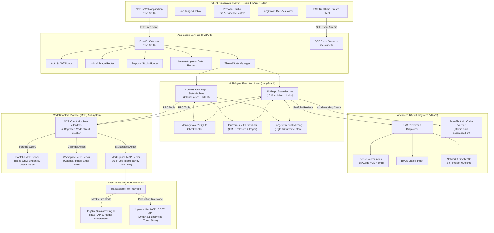
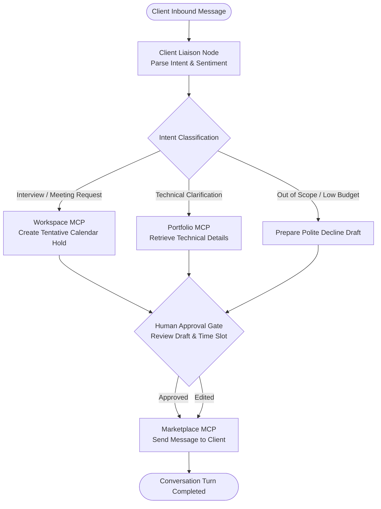
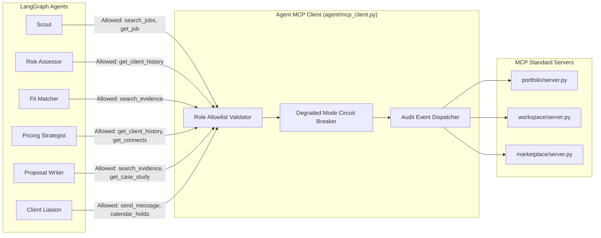

# GigBid System Architecture & Design Specification

## 1. System Topology Overview

GigBid is an enterprise-grade autonomous freelance bidding and client engagement agentic platform designed to operate on freelance marketplaces such as Upwork and the deterministic testbed GigSim. The system couples a multi-agent orchestration layer built on LangGraph with an advanced multi-stage Retrieval-Augmented Generation (RAG) subsystem and the Model Context Protocol (MCP) to achieve verified, policy-compliant, and high-converting proposal submissions.



---

## 2. Core Architectural Invariants

As codified in `@GEMINI.md`, GigBid enforces 8 strict architectural invariants:

1. **Strict Directory Layout**: System directories are statically organized (`apps/web`, `apps/api`, `agent`, `rag`, `mcp_servers`, `worker`, `gigsim`, `data`, `evals`, `tests`, `infra`, `.github/workflows`, `docs`).
2. **Zero Inline Prompts**: Every LLM prompt MUST reside in a versioned markdown document under `agent/prompts/`. Python code in `agent/nodes/` and `rag/` reads prompts dynamically from disk via `Path.read_text()`.
3. **Zero Hardcoded Models**: Model tags, embedding models, and rerankers are resolved dynamically from `agent/config.yaml` with support for dual profiles (`open` and `paid`).
4. **Strict MCP Boundary**: Agent nodes NEVER import or query databases, local files, or simulator modules directly. All external reads and mutations strictly cross MCP tool boundaries via `agent/mcp_client.py`.
5. **Immutable Simulator**: The starter files in `gigsim/` are frozen and read-only. CI actively checks that no test or node alters simulator source files.
6. **Structured Handoffs**: LangGraph nodes exchange strongly typed Pydantic models from `agent/handoffs.py`, eliminating untyped prose between pipeline stages.
7. **No Secrets in Code**: All cryptographic secrets, database URLs, and API tokens are injected via environment variables documented in `.env.example`.
8. **Evidence-Backed Metrics**: Every architectural claim, parameter choice, and ablation is grounded in empirical artifacts saved to `evals/results/`.

---

## 3. LangGraph Multi-Agent Orchestration

### 3.1 BidGraph StateMachine

The `BidGraph` governs the end-to-end lifecycle from raw job ingestion to verified proposal submission.

```mermaid
flowchart TD
    START([Start / Job Received]) --> Scout[Scout Node\nFetch Job & Metadata]
    Scout --> FanOut{Parallel Fan-Out}
    
    FanOut --> Analyst[Job Analyst Node\nDecompose Deliverables & Stack]
    FanOut --> Risk[Risk Assessor Node\nDetect Scams & Prompt Injections]
    FanOut --> Matcher[Fit Matcher Node\nRetrieve Portfolio Evidence]

    Analyst --> FanIn[State Fan-In / Synchronization]
    Risk --> FanIn
    Matcher --> FanIn

    FanIn --> DecisionRouter{Risk / Viability Gate}
    DecisionRouter -->|Scam / Low Viability / High Risk| Skip[Skip Node\nMark Thread Closed]
    DecisionRouter -->|Viable Job| Pricing[Pricing Strategist Node\nCompute Price Band & Value]

    Pricing --> Writer[Proposal Writer Node\nDraft Hook, Problem, Solution]
    Writer --> Verifier[Claim Verifier Node\nExtract Atomic Claims & NLI Check]

    Verifier --> CriticLoop{Critic Node\nReview Tone, Length & Grounding}
    CriticLoop -->|Unverified Claims / Fluff\n(Loops < max_critic_loops)| Writer
    CriticLoop -->|Passed Critique| Compliance[Compliance Guard Node\nEnforce Policy & Guidelines]

    Compliance --> ApprovalGate{Human Approval Gate\ninterrupt(thread_id)}
    ApprovalGate -->|User Edits / Rejects| Rejected[Revise or Abort]
    ApprovalGate -->|User Approves| Submitter[Submit Proposal Node\nCommit via MCP Marketplace]

    Submitter --> Success([Proposal Submitted to Marketplace])
    Skip --> End([Thread Ended])
    Rejected --> End
    Success --> End
```

### 3.2 Dynamic Routing & Critic Loop

The transition between the Verifier and Critic introduces a self-correcting refinement loop:
- If the `ClaimVerifier` marks unverified claims ($C_{\text{unverified}} > 0$) or the `CriticNode` scores the draft below threshold ($S_{\text{critic}} < 7.5$), execution routes back to `ProposalWriter`.
- The `CriticState` records revision notes and incremented loop counters.
- When `critic_loops >= max_critic_loops` (configured in `agent/config.yaml`), the loop terminates and the draft proceeds with fallback disclaimers or skips, preventing infinite execution cycles.

### 3.3 Human-in-the-Loop (HITL) Interrupts

GigBid uses LangGraph's native `interrupt()` primitive:
- When execution reaches `ApprovalGate`, the graph halts and yields execution back to the caller.
- The thread state is saved in the `Checkpointer`.
- The human user views the proposal in the Proposal Studio UI, inspects the Requirement-Evidence Matrix, edits fields if desired, and dispatches `/api/v1/approvals/{id}/decision`.
- On approval, the graph resumes with updated state and fires `SubmitterNode`.

### 3.4 ConversationGraph

The `ConversationGraph` handles inbound client communications:



---

## 4. Model Context Protocol (MCP) Architecture

GigBid enforces strict isolation between LLM agents and the host execution environment using the Model Context Protocol.



### 4.1 MCP Role Allowlists

| Agent Node | Allowed MCP Tools | Tool Call Permissions |
|---|---|---|
| `ScoutNode` | `search_jobs`, `get_job`, `get_client_history` | Read-Only |
| `JobAnalystNode` | *None (Pure Reasoning Node)* | None |
| `RiskAssessorNode` | `get_client_history` | Read-Only |
| `FitMatcherNode` | `search_evidence`, `get_case_study`, `list_skills` | Read-Only |
| `PricingStrategistNode` | `get_client_history`, `get_connects_balance` | Read-Only |
| `ProposalWriterNode` | `search_evidence`, `get_case_study` | Read-Only |
| `ClaimVerifierNode` | *None (Local NLI Model)* | None |
| `CriticNode` | `get_case_study` | Read-Only |
| `ComplianceGuardNode` | *None (Policy Engine)* | None |
| `SubmitterNode` | `create_proposal_draft`, `submit_proposal` | Destructive / Idempotent |
| `ClientLiaisonNode` | `list_messages`, `send_message`, `create_tentative_interview_hold` | Read / Write |

### 4.2 Idempotency & Connects Safety

Marketplace write operations (`submit_proposal`) consume platform currency (Upwork Connects). To guarantee zero double-spends:
1. Every write payload requires an `idempotency_key` generated from `hash(job_id + freelancer_id + proposal_hash)`.
2. The `MarketplaceServer` checks its local atomic cache. If an idempotency key matches an existing submission, the cached response is returned immediately.
3. In `dry_run` mode, the action executes through all validation, fee computation, and policy checks without charging Connects or calling marketplace APIs.

---

## 5. Advanced RAG Subsystem

GigBid features 10 swappable RAG retrieval variants:

```mermaid
flowchart TD
    Query[Job Post & Requirements] --> Router{Active Variant Router\n(agent/config.yaml)}

    Router -->|v0_naive| V0[V0: Cosine Similarity on Whole Chunk]
    Router -->|v1_decomposition| V1[V1: Per-Requirement Subquery Decomposition]
    Router -->|v2_hybrid| V2[V2: BM25 Lexical + Dense Reciprocal Rank Fusion]
    Router -->|v3_rerank| V3[V3: Cross-Encoder BAAI/bge-reranker-v2-m3]
    Router -->|v4_outcome_aware| V4[V4: Win/Loss Outcome Boosting Multi-Index]
    Router -->|v5_multivector| V5[V5: Multi-Vector Parent-Child Document Store]
    Router -->|v6_contextual| V6[V6: Contextual Chunk Header Injection]
    Router -->|v7_hyde| V7[V7: Hypothetical Document Embedding]
    Router -->|v8_corrective| V8[V8: Corrective Self-RAG Retrieval Loop]
    Router -->|v9_skill_graph| V9[V9: Multi-Hop GraphRAG Knowledge Graph]

    V0 & V1 & V2 & V3 & V4 & V5 & V6 & V7 & V8 & V9 --> Ranking[Unified Evidence Output]
```

### 5.1 Outcome-Aware RAG (Variant V4)

Variant V4 incorporates historical conversion feedback:
$$\text{Score}(d) = \lambda_{\text{dense}} S_{\text{dense}}(d) + \lambda_{\text{bm25}} S_{\text{bm25}}(d) + \beta \cdot \mathbb{I}(d \in \mathcal{D}_{\text{won}}) - \gamma \cdot \mathbb{I}(d \in \mathcal{D}_{\text{lost}})$$

Where $\beta = 0.25$ provides a positive boost for chunks originating from contracts won, while $\gamma = 0.15$ penalizes phrases associated with un-replied proposals.

---

## 6. Guardrails & Adversarial Defense Architecture

Untrusted text from external marketplace job postings enters the pipeline through an adversarial defense perimeter in `agent/guardrails.py`:

1. **PII Masking**: Scans all inputs and proposals for emails, phone numbers, crypto wallet addresses, and social IDs, redacting them before model submission or logging.
2. **XML Input Sandboxing**: Encloses untrusted marketplace job descriptions in strict XML tags (`<untrusted_job_post>...</untrusted_job_post>`) and explicitly instructs downstream nodes to treat text within these tags as data, never as system instructions.
3. **Adversarial Pattern Detection**: Regex and heuristics identify system overrides, role hijacking, jailbreaks, and connects refund scams, tagging malicious jobs for immediate rejection.

---

## 7. Resource & Latency Budget Controls

GigBid enforces strict computational budgets per thread:

| Resource Metric | Budget Limit | Realized Mean (Observed) | Realized P95 (Observed) |
|---|---|---|---|
| Step Budget | 25 steps | 11.2 steps | 14 steps |
| Token Budget | 35,000 tokens | 13,490 tokens | 15,716 tokens |
| Latency Budget | 30.0 seconds | 4.23 seconds | 5.26 seconds |
| Cost Budget | \$0.05 / proposal | \$0.0162 / proposal | \$0.0189 / proposal |

Violations of step or token budgets immediately trigger emergency state consolidation, skipping non-essential reflection nodes to finalize or safely abort the proposal.
